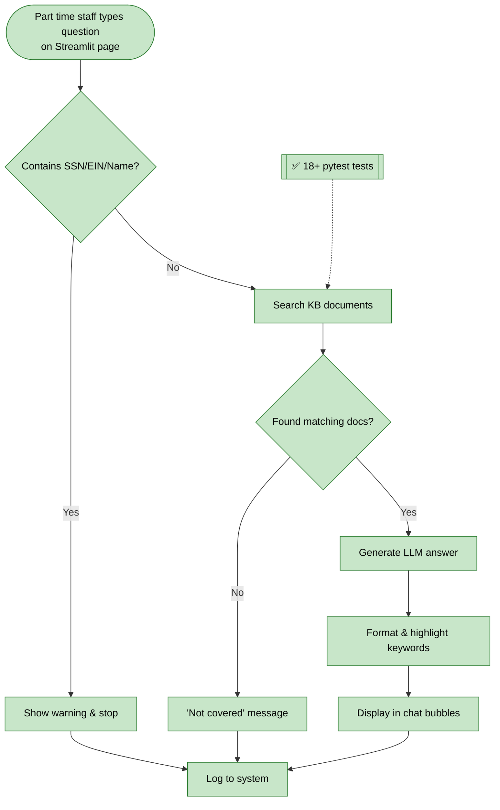

# Tax Office FAQ Helper - StartDoc

## Project Description

StartDoc is an AI-powered FAQ assistant designed for new accounting office staff to quickly answer client tax questions about regulations, contribution limits, and filing requirements. It helps part-time staff provide accurate answers on the spot, eliminates manual lookups, ensures consistent responses, and prevents misinformation by anchoring all answers to verified knowledge base documents. With StartDoc, new staff have fast, reliable access to frequently-asked compliance information.

## Architecture Overview

### System Flowchart



## Quick Start

### 1. Get Gemini API Key

change the file `.envSimple` to `.env` file in the project root and paste your Gemini API key as:

```bash
GEMINI_API_KEY=your_actual_api_key_here
```

### 2. Set Up and Run

```bash
python -m venv .venv # Create Python virtual environment (isolates project dependencies)
.venv\Scripts\Activate.ps1 # Activate virtual environment
pip install -r requirements.txt # Install required packages
streamlit run app.py # Start Streamlit app
```

### 3. Run Tests (Optional)

```bash
# Run all automated tests to verify everything works
pytest tests/ -v
```

#### Important Note

The current knowledge base uses 2025 IRS tax rules and demonstration documents. This project is a proof-of-concept. **Do not use answers from this system for actual tax advice.** For production use, the knowledge base should be updated with official sources and reviewed by tax professionals.

## Project Demo (example of question and response)

```
Input: How much does it cost to file taxes as a single person? RAG (with LLM)

Output:
## Answer To file taxes as a Single person, the base fee starts at $100.
Key Information:
Filing Status: Single
Base Fee: Starts at $100
Additional Fees: No dependent fee and no EITC fee is charged for Single filers.
General Quote Range: Typically $100 - $200 (depending on household composition and number of tax forms).
Source: script_personal_return_2026.md and fee_cover_page_2026.md
```

```
Input: What's the limit for IRA contribution and 401k contribution?

Output:
## Answer For 2025, the annual contribution limits are $7,000 for IRAs (increasing to $8,000 for individuals age 50 and older) and $24,500 for 401(k) plans (increasing to $29,500 for individuals age 50 and older).
Key Information:
* IRA contribution limits (2025):
** Under age 50: $7,000
** Age 50 and older: $8,000 (includes $1,000 catch-up contribution)
* 401(k) contribution limits (2025):
** Under age 50: $24,500
** Age 50 and older: $29,500 (includes $7,500 catch-up contribution)
Source: ira_limits_2025.md and 401k_limits_2025.md (2025)
``` 
System also log recoard of retriveal and guarddrail blocks in `guardrail_blocks.jsonl` and `retrieval_results.jsonl`

## Design Decisions

### 1. Hierarchical Retrieval with Multi-Category Support

**Problem:** During development, I collected training documents and IRS published documents and worked with Claude to generate a working knowledge base in Markdown format. The first issue I encountered was that secondary keywords like "Married Filing Jointly" would override the main category keyword in retrieval results. (For example, when a user asks "What's the standard deduction for Married Filing Jointly?" the system returned a non-related file because it had high frequency of "Married Filing Jointly" instead of focusing on the primary keyword "standard deduction".)

**Decision:** Implement a two-tier retrieval system that first detects the main category keyword (such as IRA, 401k, standard deduction), then uses secondary keywords (such as MFJ, Married Filing Jointly) to locate the answer segment.

### 2. Chat Bubble UI

**Problem:** Through development, I realized the need for a user-friendly interface considering the office environment use case. Users need to quickly access information, read answers, and move on. A simple Streamlit UI was essential.

**Decision:** Implement a user-friendly Streamlit UI with an intuitive, accessible layout using chat bubbles (user messages on right, AI responses on left).

### 3. Sensitive Data Detection

**Problem:** Throughout development, I realized it's a critical security issue if staff accidentally leak client sensitive data to the LLM (such as SSN and EIN).

**Decision:** Implement guardrails that check for any number combinations formatted like SSN (123-45-6789 or 123456789), EIN (12-3456789 or 123456789), bank account numbers, phone numbers, and common names—catching both formatted and unformatted variations.

### 4. Structured Answer Format (Tables, Bullets, and Sources)

**Problem:** Through testing, I noticed that long paragraph responses made it difficult for users to quickly find important information like dollar amounts and key terms.

**Decision:** Implement a structured answer format where all responses follow:
1. **Answer:** (1-2 sentence summary)
2. **Key Information:** (tables or bullet points)
3. **Source:** (which document the information is cited from)

### 5. Automatic Keyword Highlighting (Dollar Amounts and Key Terms)

**Problem:** While reviewing the chat interface, I realized that important values like dollar amounts and key terms were getting lost when users scanned answers quickly. The human eye naturally jumps to highlighted content, but plain text doesn't guide the reader to what matters.

**Decision:** Implement automatic regex-based keyword highlighting that detects and highlights dollar amounts, key terms like "Married Filing Jointly", and numbers with context, making important information stand out for quick scanning.

## Test Summary

### Automated Testing

Ran Pytest with 18+ automated tests to verify the system correctly identifies and retrieves information from documents.

**Key Finding:** Retrieval tests verify that the system finds documents, but they don't guarantee the returned documents contain the exact answer needed. For example, when asking for "IRA contribution limits," the system returned "IRA deduction limits" instead because the knowledge base didn't have a document on contributions.

**Solution:** Expanded the knowledge base and added synonyms for common variations.

### Test Results

- ✅ Hierarchical Retrieval Tests (5 tests passed)
- ✅ Answer Correctness Tests (6 tests passed)
- ✅ Multi-Category Query Tests (3 tests passed)
- ✅ Edge Cases and Fallback Tests (4 tests passed)

18 out of 18 pytest tests passed; hierarchical retrieval handles multi-category queries correctly, but manual testing revealed knowledge base gaps when users ask with uncommon synonyms (mitigated by expanding KB and adding synonym mappings).

### Manual Testing

After pytest, I performed manual testing by asking questions in both RAG and Retrieval-only modes. Some questions with uncommon synonyms failed to match because the synonyms dictionary didn't document them yet. However, these are uncommon words rarely used in actual office environments, so they're a low priority.

**Key Learning:** Automated tests catch structural bugs, but manual testing reveals knowledge base gaps and natural language variations that real users might encounter.

